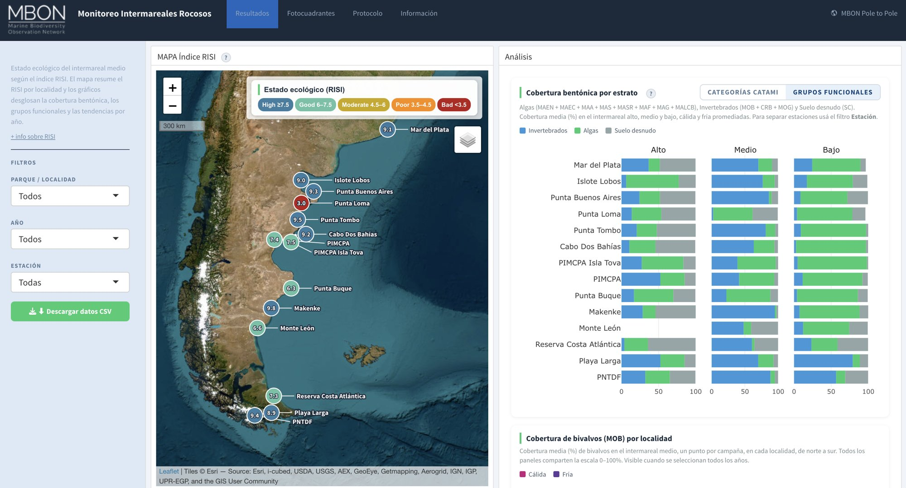
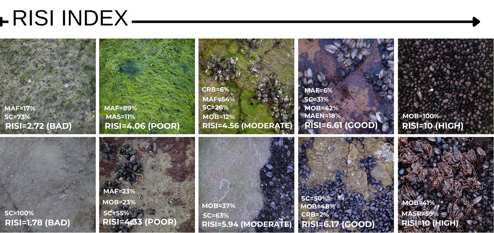

# Rocky Intertidal Monitoring Dashboard

Interactive dashboard for exploring rocky intertidal monitoring data from the **MBON Pole to Pole** network along the Patagonian coast of Argentina. It summarizes thousands of photoquadrats annotated with AI-assisted image classification in **CoralNet**. The dashboard shows ecological condition, benthic cover and sampling effort through time and across sites.

🔗 **Live dashboard:** https://mbon-poletopole.shinyapps.io/monitoreo-intermareal/



---

## What the dashboard shows

The interface is in Spanish and has four tabs.

**Resultados (Results)**
- **RISI map**: mean ecological condition of each locality (or each site, when a locality is selected), coloured by status class.
- **Benthic cover by tidal level** (high, mid, low): cover can be shown as CATAMI categories or functional groups (invertebrates, algae, bare substrate).
- **Mussel cover (MOB) through time**: one point per sampling campaign (warm and cold season) for each locality or site.
- **RISI by locality/site and year**: a heatmap. Clicking a cell opens the corresponding photoquadrats in CoralNet.
- **Distribution of RISI classes** across photoquadrats.
- **CSV download** of the filtered mid-intertidal data with RISI values.

**Fotocuadrantes (Photoquadrats)**
- Map of every photoquadrat.
- Sampling-effort heatmap (locality × campaign).
- Effort metrics: photoquadrats, equivalent area, field days and sites.
- Direct link to the selected images in CoralNet. When a season is selected, the link filters by date range.

**Protocolo (Protocol)**
- Page-by-page viewer of the sampling protocol, with a link to the official version in Ocean Best Practices.

**Información (Information)**
- Project background, publications and contact.

Filters cascade: each selector offers only the values that exist for the selections above it (locality → site → year → season → stratum).

---

## RISI — Rocky Intertidal Status Index

The RISI summarizes the ecological condition of the **mid-intertidal** on a **0–10** scale, based on benthic cover in each photoquadrat.

- **High values**: the community is dominated by biogenic, habitat-forming structure (mussel beds, sheet-like algae).
- **Low values**: bare rock or filamentous algal turf dominates.

The index has two components:

- **BIO** (habitat-forming organisms) raises it.
- **TBS** (turf and bare substrate, scored inversely) lowers it.

RISI is computed for each photoquadrat and then averaged by site, locality and campaign.

| Class | RISI |
|---|---|
| High | ≥ 7.5 |
| Good | 6.0 – 7.5 |
| Moderate | 4.5 – 6.0 |
| Poor | 3.5 – 4.5 |
| Bad | < 3.5 |



The full definition (weights, thresholds, seasonal adjustment and collapse rule) is in the code: see the `risi_params` chunk of `RISI_dashboard_v3.Rmd`. The method and its validation are described in Bravo et al. (in preparation).

---

## Data

- **Source:** CoralNet source [MBON P2P Intertidal Monitoring (ARG_UY)](https://coralnet.ucsd.edu/source/2897/).
- **Classification:** benthic categories follow the **CATAMI** scheme, which is based on morphology and growth form and is suited to image-based annotation.
- **Files:** `DATA/metadata.csv` (image metadata) and `DATA/percent_covers.csv` (percent cover per image), both exported from CoralNet.
- **Updating the dashboard:** replace these two CSVs with a new export. The data cache (`DATA/AMP_cache.rds`) is rebuilt automatically when they change.
- **Metadata corrections:** applied directly in CoralNet; the correction files are kept locally and are not part of this repository.

---

## Running locally

Open `RISI_dashboard_v3.Rmd` in RStudio and click **Run Document**.

Required packages: `flexdashboard`, `shiny`, `dplyr`, `tidyr`, `readr`, `lubridate`, `leaflet`, `plotly`, `ggplot2`, `RColorBrewer`, `scales`, `forcats`, `stringr`, `htmlwidgets`.

To deploy to shinyapps.io:

```r
rsconnect::deployApp(appPrimaryDoc = "RISI_dashboard_v3.Rmd",
                     appName = "monitoreo-intermareal")
```

Files that should not be uploaded (raw annotations, originals of images, older dashboard versions) are listed in `.rscignore`.

---

## Protocol and publications

- Intertidal monitoring protocol (Ocean Best Practices): https://repository.oceanbestpractices.org/handle/11329/2199.2
- MBON Intertidal Monitoring Workshop 2024 (RIO Journal): https://riojournal.com/article/126660/
- MBON Intertidal Monitoring Workshop 2025 (RIO Journal): https://riojournal.com/article/163815/

---

## Project status

⚠️ Under active development. The current version covers monitoring sites in **Argentina**. Sites from other participating countries will be added as data are processed and harmonized.

---

## Author

**Dr. Gonzalo Bravo**
Implementation of Artificial Intelligence Tools for Marine Biodiversity Monitoring in Protected Areas
Marine Biodiversity Observation Network (MBON) – Pole to Pole
